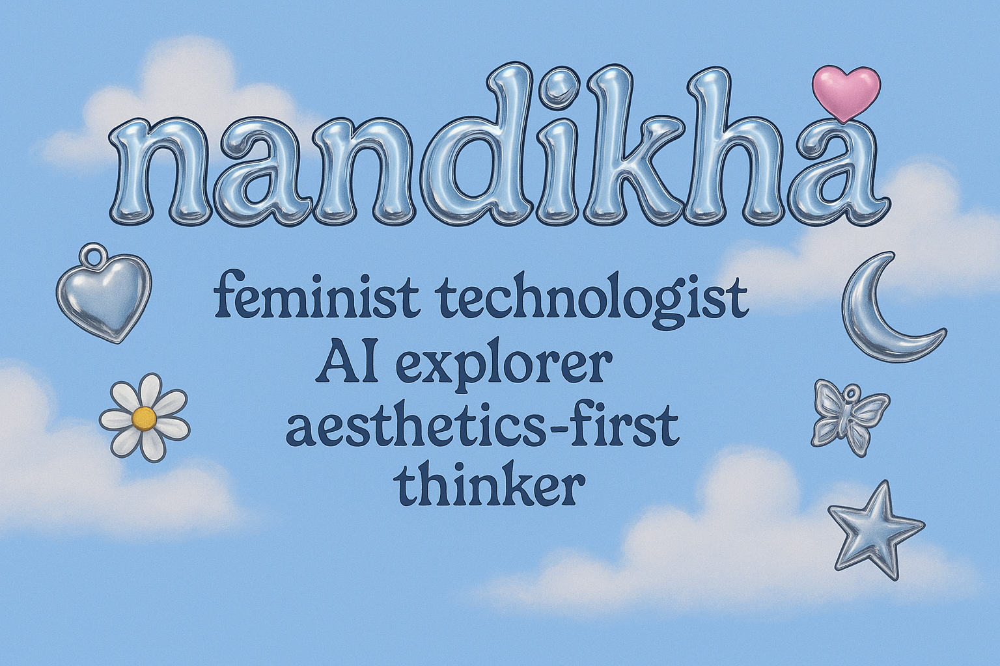

<h1 align="center">hi, i'm nandikha ♡</h1>

✨ M.Sc. Autonomous Systems • AI Research • Robotics & Intelligent Systems ✨
  
🎓 B.Tech in Computer Science & Engineering — SRMIST, Chennai
  
🎓 M.Sc. Autonomous Systems — Hochschule Bonn-Rhein-Sieg, Germany
  
🔭 Exploring intelligent systems at the intersection of AI, robotics & healthcare technology
  
🌱 Currently exploring: Healthcare AI, Medical Robotics, Computer Vision, Reinforcement Learning & AI for Scientific Research

  

---

## 💻 what i do
- 🧠 Explore **AI and intelligent systems** for real-world applications and scientific discovery
- 🤖 Work with **robotics and autonomous systems**, exploring intelligent decision-making, optimization and human-robot interaction
- 📷 Build **computer vision systems** using deep learning, object detection and OCR
- 🧬 Explore **Healthcare AI and Medical Technology**, particularly AI-driven approaches to healthcare challenges
- ⚛️ Investigate **reinforcement learning, quantum machine learning and optimization algorithms**
- 🔬 Interested in **AI for Scientific Research**, especially at the intersection of engineering, healthcare and computational intelligence
- 🎨 Believe good technology should be *useful, ethical, accessible and aesthetically thoughtful*

---

## 🚧 flagship projects

### 🚗 Parkour — Smart Parking System
- Quantum ML-based smart parking solution
- YOLOv11v2 + OCR for license plate detection and recognition
- Quantum Reinforcement Learning for optimized parking slot allocation
- 📈 97.7% license plate recognition accuracy | 15%+ improvement in space utilization
- 📄 Patent filed (2025)

### 🧠 Smartalk — AI-Powered Customer Support
- AI-powered customer support platform using **Retrieval-Augmented Generation (RAG)**
- Semantic retrieval using vector databases (Milvus, Pinecone)
- HNSW indexing and cosine similarity for efficient information retrieval
- Focused on building context-aware and relevant conversational experiences

### 🧬 Data-Driven IVF Success Predictor
- Machine learning system for predicting IVF cycle success probability
- Used patient-specific biomarkers including AMH, BMI, age and hormonal indicators
- Reinforcement Learning (PPO) to explore optimized treatment pathways
- Simulated adaptive treatment strategies across patient cohorts
- 🎯 Explored improvements in prediction performance over baseline ML models
- 🌸 Developed with an interest in ethical AI and healthcare applications

---

## 🔬 research interests
- 🧬 Healthcare AI & Medical Technology
- 🤖 Medical Robotics & Autonomous Systems
- 📷 Computer Vision & Deep Learning
- 🧠 Reinforcement Learning & Intelligent Decision-Making
- ⚛️ Quantum Machine Learning
- 🔬 AI for Scientific Research
- 🦾 Human-Robot Interaction
- 📊 Optimization Algorithms
- 🧠 Neuroengineering

---

### 🛠 tech stack

#### languages

#### AI / ML

#### robotics & intelligent systems

#### data & systems

#### tools

---

### 🌸 let's connect
- 💼 [LinkedIn - Nandikha T](https://www.linkedin.com/in/nandikha-t-609503283)
- 📝 [More coming soon – portfolio site under construction]

---

<i>"What if I'm not just a software engineer/ data analyst, but also a storyteller, an aesthete, a dreamer designing futures?"</i>

